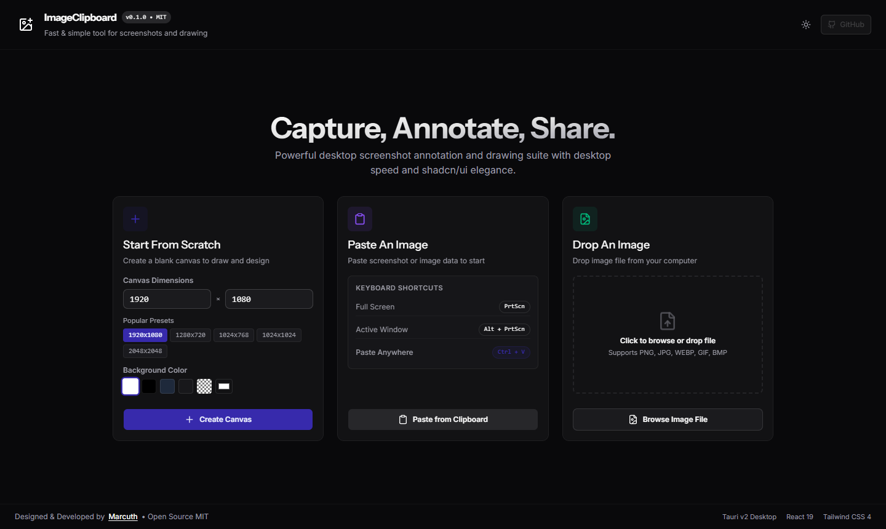
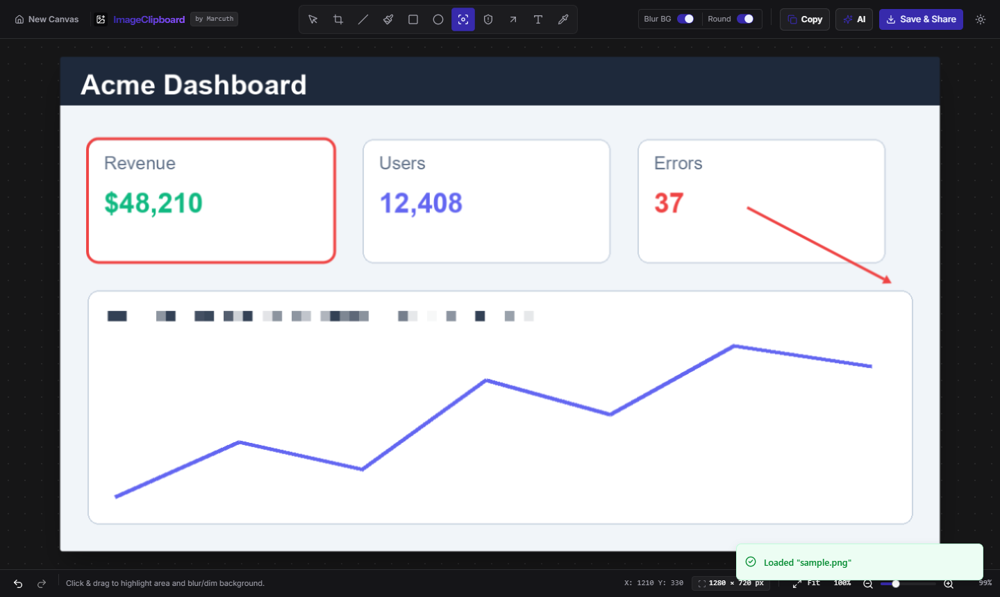
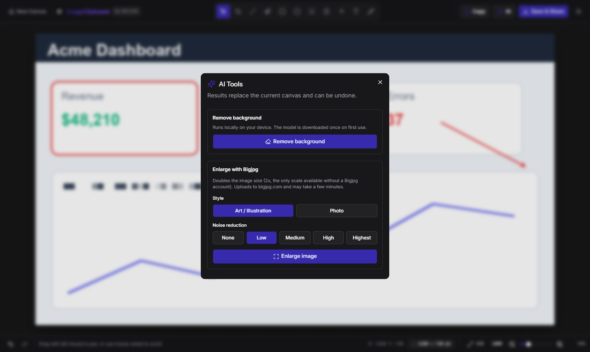
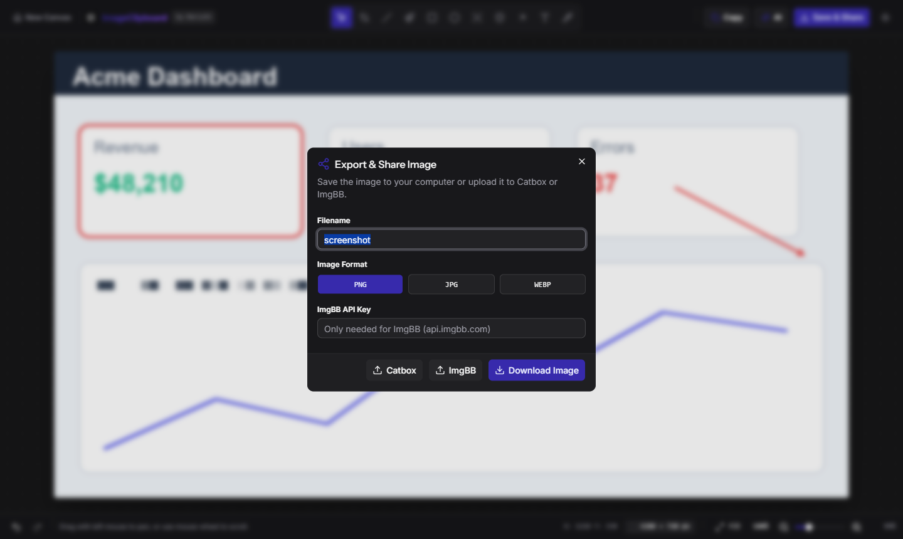

# 📋 ImageClipboard

<p align="center">
  
</p>

<p align="center">
  <strong>Fast, sleek, and modern desktop screenshot, drawing, and annotation suite.</strong><br />
  Built for the modern desktop with <strong>Tauri v2</strong>, <strong>React 19</strong>, <strong>Tailwind CSS 4</strong>, and <strong>shadcn/ui</strong>.
</p>

<p align="center">
  <a href="https://github.com/marcuth/image-clipboard/releases/latest"></a>
  <a href="https://github.com/marcuth/image-clipboard/releases"></a>
  <a href="LICENSE"></a>
  <a href="https://tauri.app/"></a>
  <a href="https://react.dev/"></a>
  <a href="https://tailwindcss.com/"></a>
</p>

<p align="center">
  <a href="https://github.com/marcuth/image-clipboard/releases/latest"><strong>Download Latest Release</strong></a> •
  <a href="https://github.com/marcuth/image-clipboard/releases">All Releases</a> •
  <a href="https://github.com/marcuth/image-clipboard/issues">Report Bug</a> •
  <a href="https://marcuth.dev">Author Website</a>
</p>

---

## ⚡ What It Does

ImageClipboard turns a screenshot into a finished, shareable image in seconds. Paste it, crop it, mark it up, hide what is private, then copy it, save it or upload it. Everything is processed on your computer; nothing leaves it unless you press an upload or enlarge button.

- Start from a pasted screenshot, a dropped file or a blank canvas.
- Annotate with a brush, lines, shapes, arrows and text.
- Hide sensitive data with blur, or spotlight what matters.
- Remove the background of any image, locally.
- Enlarge an image 2x with AI.
- Copy, download, or upload to Catbox or ImgBB.

---

## 📥 Releases & Downloads

Pre-built binaries for Windows, macOS, and Linux are available on the GitHub Releases page:

👉 **[Download the Latest Release](https://github.com/marcuth/image-clipboard/releases/latest)**

| Platform    | Package Format           | Status    |
| :---------- | :----------------------- | :-------- |
| **Windows** | `.msi`, `.exe` installer | Supported |
| **macOS**   | `.dmg`, `.app`           | Supported |
| **Linux**   | `.deb`, `.AppImage`      | Supported |

---

## 🖼 Tour

### Welcome screen



The app opens maximized on the welcome screen with three ways to begin:

- **Start From Scratch:** pick a size (presets like 1920×1080, 1280×720 or 1024×1024, or your own) and a background color, including transparent.
- **Paste An Image:** press `Ctrl+V` anywhere to load an image from the clipboard.
- **Drop An Image:** drag a PNG, JPG, WEBP, GIF or BMP file in, or click to browse.

The moon/sun button switches between dark and light themes.

### Editor


Opening an image lands you in the editor with the **Crop** tool active. The top bar holds the tools in the middle and the actions on the right (Copy, AI, Save & Share, theme). The bottom bar has undo/redo, the cursor position, the canvas size and the zoom controls.

### Annotating


Pick a tool, and its options (color, stroke weight, rounded corners and so on) appear in the top bar. This example uses **Blur** on a secret token, a **Rectangle** around a card and an **Arrow** pointing at a value.



Each tool shows only the options that apply to it. **Focus** can blur and dim everything outside the highlighted area.

### AI tools



Open them with the **AI** button. The result replaces the canvas and can be undone with `Ctrl+Z`.

- **Remove background:** runs entirely on your device. The first use downloads the model once and then works from cache.
- **Enlarge with Bigjpg:** doubles the image size (2x, the only scale Bigjpg offers without an account). Choose **Art / Illustration** or **Photo**, and a noise-reduction level. The image is sent to bigjpg.com, and processing can take a few minutes.

### Save & Share



Open it with **Save & Share** or `Ctrl+S`.

- Set the **filename** and **format**: PNG, JPG or WEBP (with a quality slider for JPG and WEBP).
- **Download Image** saves the file.
- **Catbox** uploads anonymously and gives you a link to copy.
- **ImgBB** uploads with your own API key. Get a free key at [api.imgbb.com](https://api.imgbb.com/), paste it in the field, and it is remembered on this computer.

---

## 🎨 Tools

| Key | Tool              | What it does                                                             |
| :-: | :---------------- | :----------------------------------------------------------------------- |
| `V` | **Select & Pan**  | Move around the canvas.                                                  |
| `C` | **Crop**          | Drag a box, then `Enter` to apply or `Esc` to cancel.                    |
| `L` | **Line**          | Straight line. Hold `Shift` to snap to 45° steps.                        |
| `B` | **Brush**         | Freehand drawing with optional smoothing.                                |
| `R` | **Rectangle**     | Stroke and fill, optional rounded corners. `Shift` makes a square.       |
| `E` | **Ellipse**       | Ellipse or circle. `Shift` makes a circle, `Ctrl` draws from the center. |
| `F` | **Focus**         | Spotlight an area and dim or blur the rest.                              |
| `X` | **Blur & Censor** | Pixelate passwords, tokens and personal data.                            |
| `A` | **Arrow**         | Arrow pointing at a target.                                              |
| `T` | **Text**          | Click to type a label, `Enter` to place it.                              |
| `I` | **Eyedropper**    | Pick a color from the image.                                             |

Color and stroke weight (1–48 px) are set from the top bar. Zoom with `Ctrl` + mouse wheel (10%–500%), pan with the wheel, or use the **Fit** and **100%** buttons.

---

## ⌨️ Keyboard Shortcuts

| Shortcut                                    | Action                            |
| :------------------------------------------ | :-------------------------------- |
| `Ctrl + V`                                  | Paste image from clipboard        |
| `Ctrl + C`                                  | Copy the canvas to the clipboard  |
| `Ctrl + S`                                  | Open Save & Share                 |
| `Ctrl + Z`                                  | Undo                              |
| `Ctrl + Y` / `Ctrl + Shift + Z`             | Redo                              |
| `V` `C` `L` `B` `R` `E` `F` `X` `A` `T` `I` | Switch tool (see the table above) |
| `Enter`                                     | Apply crop or place text          |
| `Esc`                                       | Cancel crop or text               |
| `Shift` (hold)                              | Snap angles, or force 1:1 shapes  |
| `Ctrl` + wheel                              | Zoom                              |

---

## ❓ Good To Know

- **Privacy:** images stay on your computer unless you use Catbox, ImgBB or Bigjpg. Catbox and ImgBB links are public.
- **Undo covers AI results:** background removal and enlargement can be reverted.
- **Transparent images:** shown over a checkerboard, and PNG keeps the transparency on export.
- **Upload fails?** Check your connection and, for ImgBB, that the API key is valid. The error message from the service is shown in the notification.

---

## 🚀 Building From Source

### Prerequisites

- [Node.js](https://nodejs.org/) (v18+)
- [Rust](https://www.rust-lang.org/) & Cargo (latest stable)

### Getting Started

```bash
# 1. Clone the repository
git clone https://github.com/marcuth/image-clipboard.git
cd ImageClipboard

# 2. Install dependencies
npm install

# 3. Start Vite frontend dev server
npm run dev

# 4. Run the full Tauri desktop application
npm run tauri dev
```

### Production Build

```bash
# Compile TypeScript & build frontend
npm run build

# Package the native desktop binary
npm run tauri build
```

Contributors: see [AGENTS.md](AGENTS.md) and [CLAUDE.md](CLAUDE.md) for code guidelines and architecture.

The compiled desktop installer and executable will be available inside `src-tauri/target/release/bundle/`.

---

## 📜 License

This project is licensed under the **MIT License** — see the [LICENSE](LICENSE) file for details.

Developed with ❤️ by **[Marcuth](https://marcuth.dev)**.
